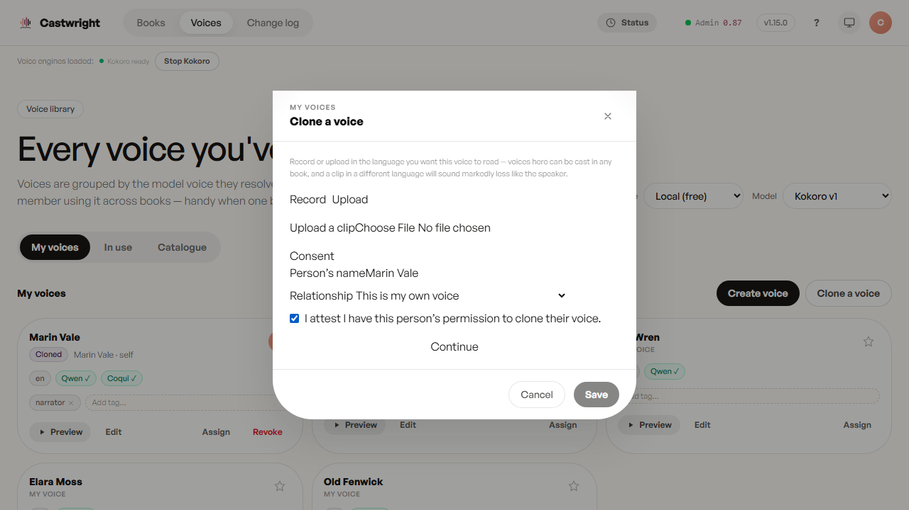
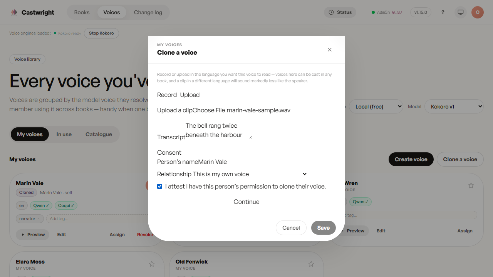
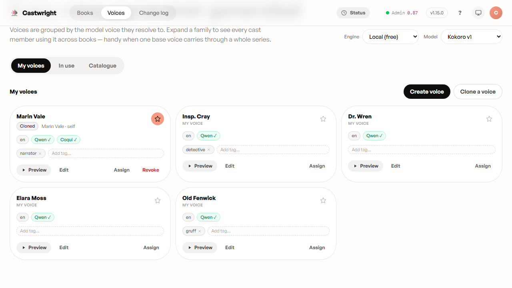
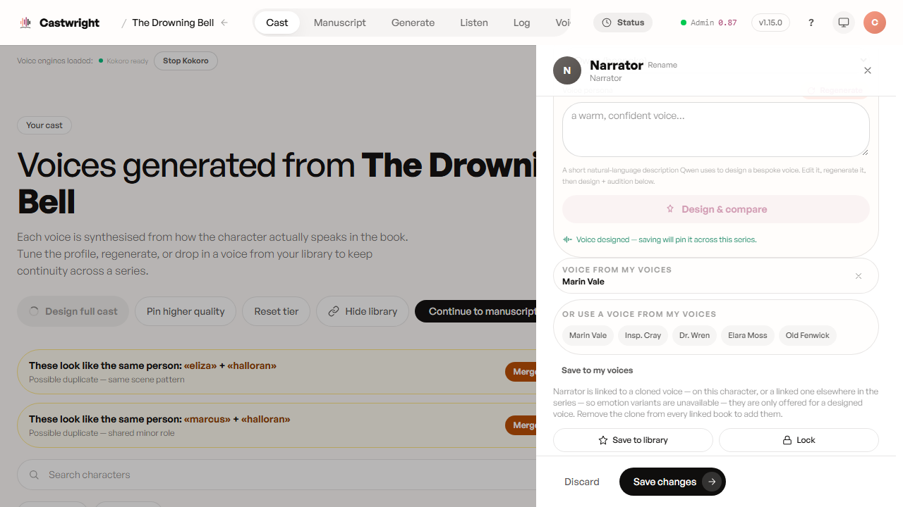

# Cloning a Voice

Designing a voice gives a character someone new. Cloning gives a character someone you know: you, or a family member who has said yes. Record or upload a short sample, confirm whose voice it is, and Castwright builds a voice you can cast in any book, on either of the two engines that can carry a clone, Qwen and Coqui XTTS v2.

Cloning lives in **Voices → My voices**, next to the voices you've designed. Press **Clone a voice** to open the wizard.

## 1. Consent comes first

The wizard won't build a clone without a consent record. Fill in:

- **Person's name**: whose voice this is.
- **Relationship**: **This is my own voice**, **A family member, with their permission**, or **My child (I'm their guardian)**.
- **Your name (the attester)**: asked only when the voice isn't yours, so the record says who gave consent. Castwright refuses the clone without it.
- The attestation box. Its sentence fits the relationship you picked: for a family member it says you have their permission to clone their voice, and for a child it reads "I attest, as this child's guardian, that I consent to cloning their voice."

The consent record stays with the voice. Its My voices card shows the person and the relationship under a **Cloned** badge.

<picture>
  <source media="(prefers-color-scheme: dark)" srcset="images/cloning-a-voice/01-consent-dark.png">
  <source media="(prefers-color-scheme: light)" srcset="images/cloning-a-voice/01-consent.png">
  
</picture>

## 2. Record or upload a sample

Choose **Record** to use your microphone, or **Upload** to pick an audio file. Castwright transcribes the clip and shows the text in the **Transcript** field. Read it through: if a word was misheard, correct it, because your edited text is what the voice is built from. A transcript that's too long is flagged while you can still trim it.

When consent is complete and the sample is in, press **Continue**, give the voice a name (it defaults to the person's name), and press **Save**. Castwright builds the voice and offers a **Play preview** so you can hear it before you press **Done**.

<picture>
  <source media="(prefers-color-scheme: dark)" srcset="images/cloning-a-voice/02-sample-dark.png">
  <source media="(prefers-color-scheme: light)" srcset="images/cloning-a-voice/02-sample.png">
  
</picture>

### Record in the language the voice will read

A clone can be cast in any book, in any language, and it reads a non-English book in that book's language. It sounds most like its owner in the language the sample was recorded in, though. A clip in a different language will sound noticeably less like the speaker. The wizard says so before you record, and if you cast a clone into a book in another language, Castwright warns you when you assign it. It never blocks you.

## 3. Your clone in My voices

The clone sits in **My voices** beside your designed voices, with a **Cloned** badge, the consent line, and a chip for each engine it's ready on (**Qwen ✓**, **Coqui ✓**). From the card you can **Preview** it, tag it, pin it, or **Revoke** it. To put it on a character, use the Cast screen (next section).

<picture>
  <source media="(prefers-color-scheme: dark)" srcset="images/cloning-a-voice/03-my-voices-cloned-dark.png">
  <source media="(prefers-color-scheme: light)" srcset="images/cloning-a-voice/03-my-voices-cloned.png">
  
</picture>

## 4. Cast it on a character

Open a character's profile drawer on the Cast screen and pick the clone under **Or use a voice from My voices**. The drawer then shows it under **Voice from My voices**, with an × to take it back off the character. Below, the narrator of *The Drowning Bell* is cast on the author's own cloned voice.

<picture>
  <source media="(prefers-color-scheme: dark)" srcset="images/cloning-a-voice/04-cast-cloned-voice-dark.png">
  <source media="(prefers-color-scheme: light)" srcset="images/cloning-a-voice/04-cast-cloned-voice.png">
  
</picture>

A clone is protected from being overwritten once it's cast. A redesign or **Design full cast** won't overwrite it, and emotion variants aren't offered for it, because they wouldn't be the recording you were given permission to use.

## Both engines

A clone works on **Qwen** and on **Coqui XTTS v2** ([Voice Engines](Voice-Engines)). If the book is set to an engine that can't carry a clone, or the clone can't be rebuilt as itself, Castwright stops and says why rather than reading the line in someone else's voice. **Approve cast & start generating** checks every clone against the book's engine first and offers a fix: add the missing transcript, retry the rebuild, cast on the other engine, or pick a different voice. If you set Coqui up before v1.15.0, re-run its install from **Model Manager**, or press **Repair**, to pick up the cloning fixes.

## It stays on your machine

Cloning runs on your own computer with the local Qwen and Coqui engines. Your sample and the voice built from it stay on your machine. **Revoke** erases the recording and the voice built from it, after telling you what you'll lose. This can't be undone. Chapters you've already generated keep the cloned voice until you re-cast that character and regenerate them.

## Related

- [Designing a Voice](Designing-a-Voice): describe a persona and get a new voice instead.
- [Reviewing Cast & Assigning Voices](Reviewing-Cast-and-Assigning-Voices)
- [Release Notes v1.15.0](Release-Notes-v1.15.0)
